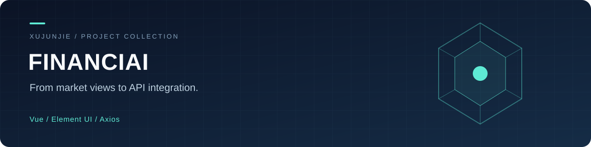

# Financiai · 行情分析与模拟交易界面
> 以股票行情场景展示 Vue 前端开发、图表交互和后端接口联调。

**Vue 2.7 · Element UI · Vuex · Vue Router · ECharts · Axios**

## 项目定位

本项目包含股票行情、K 线详情、模拟交易、个人中心和 AI 分析交互界面。当前代码以真实后端代理模式为主，仓库内同时保留 Mock 代码与接口协作文档。

## 功能导航

| 方向 | 入口 |
| --- | --- |
| 行情与图表 | [StockQuote.vue](src/components/stock/StockQuote.vue)、[KLineChart.vue](src/components/stock/KLineChart.vue) |
| 交易交互 | [TradePanel.vue](src/components/trade/TradePanel.vue) |
| 分析页面 | [AIPrediction.vue](src/components/ai/AIPrediction.vue)、[AISelectStock.vue](src/components/ai/AISelectStock.vue) |
| 用户与登录 | [个人中心](src/components/mine/Mine.vue)、[登录页](src/views/login/index.vue) |
| 联调文档 | [API 汇总](docs/API_INTEGRATION_SUMMARY.md)、[接口速查](docs/ONE_PAGE_API.md) |

## 实现亮点

- **统一请求层**：[request.js](src/utils/request.js) 封装请求实例、鉴权信息、Token 刷新和错误提示。
- **业务格式转换**：请求工具提供股票代码前缀补齐与移除，适配前后端代码格式。
- **账号数据整理**：[main.js](src/main.js) 包含历史模拟交易缓存清理，处理旧版全局数据残留。
- **联调资料沉淀**：[docs/](docs/) 保留用户、行情与 AI 功能的接口需求及对接说明。

## 本地运行

依赖与锁定版本见 [package.json](package.json) 和 `package-lock.json`。在兼容 Vue CLI 5 的环境中准备好原项目依赖后：

```bash
npm run serve
npm run build
```

默认开发端口为 `8089`。联调前检查：

1. [vue.config.js](vue.config.js) 中 `/api`、`/ai-api` 的代理目标。
2. 请求层使用的 `VUE_APP_API_BASE_URL` 与 `VUE_APP_AI_API_BASE_URL`。
3. 后端是否提供对应的登录、行情、交易和分析接口。

当前 [main.js](src/main.js) 中 Mock 导入处于注释状态；启动前端并不等于后端服务可用。仓库未配置 `npm run lint`。

## 展示建议

按“登录 → 行情筛选 → 股票详情 → 模拟交易 → 分析页面”展示。讲解统一请求层和接口文档如何支持联调，比仅展示页面更能说明工程实现。

## 项目边界与授权

AI 页面依赖外部接口，仓库本身未包含可独立验证的预测模型。根目录尚无项目许可证，第三方资源和依赖需分别确认授权。
